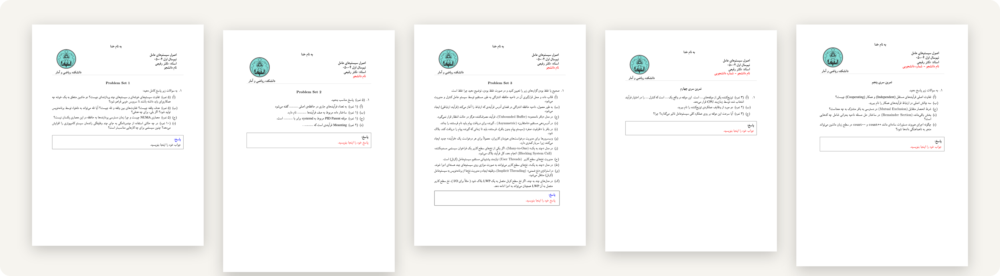
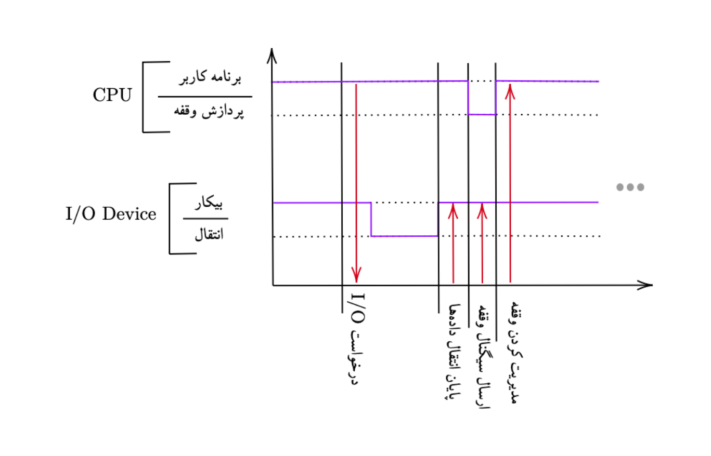
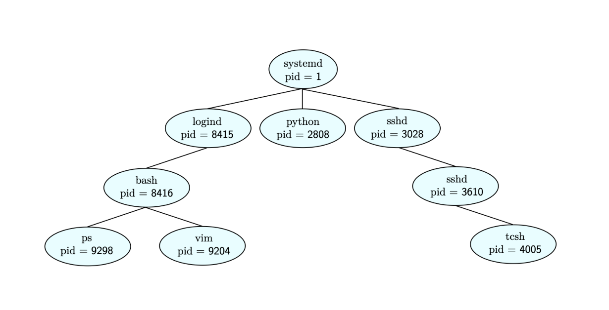

<div align="center">

# Principles of Operating Systems

*Problem sets and solutions &nbsp;·&nbsp; University of Isfahan &nbsp;·&nbsp; Fall 2025*

<br>



</div>

<br>

Five problem sets from Dr. Rafiee's operating systems course, where I was a teaching assistant, with their solutions. They follow the course from what an operating system is, through processes, threads and scheduling, to synchronization. Everything is in Persian and typeset with XeLaTeX.

| Set | Topic | Problems | Solutions |
| :-- | :-- | :-- | :-- |
| [**1**](ps-01) | **Overview:** clusters and multiprocessors, dual-mode operation, interrupts and DMA, booting | [PDF](ps-01/problems.pdf) | [PDF](ps-01/solutions.pdf) |
| [**2**](ps-02) | **Processes:** process states, orphans and zombies, process trees, `fork` and `wait` | [PDF](ps-02/problems.pdf) | |
| [**3**](ps-03) | **IPC and threads:** shared memory and message passing, mailboxes, thread pools, pthreads | [PDF](ps-03/problems.pdf) | [PDF](ps-03/solutions.pdf) |
| [**4**](ps-04) | **CPU scheduling:** the dispatcher, preemption, FCFS, SJF and round robin, predicting the next burst | [PDF](ps-04/problems.pdf) | [PDF](ps-04/solutions.pdf) |
| [**5**](ps-05) | **Synchronization:** the critical section, Dekker and Peterson, TSL, spinlocks, semaphores and monitors | [PDF](ps-05/problems.pdf) | [PDF](ps-05/solutions.pdf) |

<table>
<tr>
<td width="50%" valign="top">

<p align="center"><sub>An interrupt-driven I/O transfer, from set 1</sub></p>
</td>
<td width="50%" valign="top">

<p align="center"><sub>A Linux process tree, from set 2</sub></p>
</td>
</tr>
</table>

## Layout

Each set lives in its own folder. `problems.tex` is the handout students received, with an empty box under each question for their answer; `solutions.tex` is the same set with the boxes filled in. Both read their questions from `src/` where a set has one. Set 2 was never written up with solutions, and set 3's solutions leave out the answers that are code.

## Building

You'll need a TeX distribution with XeLaTeX and [xepersian](https://ctan.org/pkg/xepersian), and the XB Yas font family (regular, bold, italic and bold italic) in a `fonts/` folder at the root. Then, from the root:

```bash
latexmk ps-04/solutions.tex
```

The included `.latexmkrc` selects XeLaTeX, keeps auxiliary files in `out/`, and writes the PDF next to its source.

## Credits

Written by the course's teaching assistants, among them Davoud Nosrati Amirabadi ([@ausdavoud](https://github.com/ausdavoud)), for Dr. Rafiee's course at the Faculty of Mathematics and Statistics, University of Isfahan.
